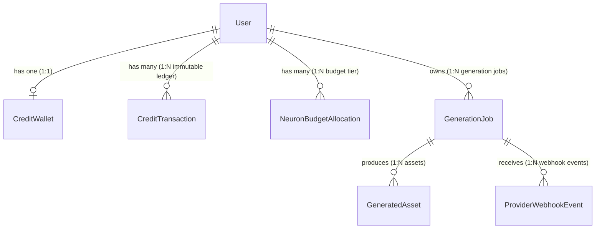
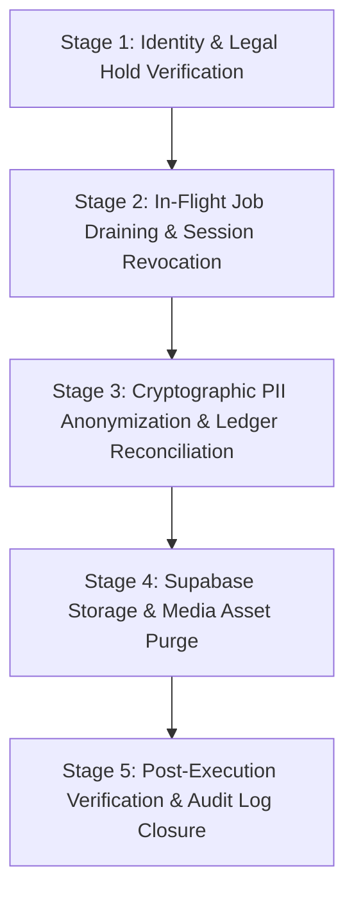

# Pixora Standard Operating Procedure (SOP): Safe Administrative Account Deletion & Ledger Preservation

- **Document ID**: SOP-OPS-004
- **Version**: 1.1.0
- **Effective Date**: 2026-11-11
- **Status**: APPROVED / ACTIVE
- **Classification**: INTERNAL OPERATIONAL RUNBOOK
- **Target Audience**: Systems Engineers, Site Reliability Engineers (SRE), Compliance & Legal Operations
- **Implementation Status**: **DOCUMENTATION ONLY — ZERO DELETION SCRIPTS IMPLEMENTED OR EXECUTED**

---

## 1. Executive Summary & Strict Invariant Notice

> [!CAUTION]
> **STRICT ADMINISTRATIVE PROHIBITION: NEVER EXECUTE DESTRUCTIVE CASCADE DELETION.**
> Hard-deleting rows directly from the PostgreSQL `"User"` table (`DELETE FROM "User" WHERE id = ...`) is **strictly forbidden**.
> Executing destructive relational deletion triggers foreign key constraint violations, orphans immutable double-entry financial ledger lines (`CreditTransaction`), and destroys audit integrity.
> **No deletion scripts are implemented, provided, or executed.** Account decommissioning is an administrative procedure governed strictly via **cryptographic pseudonymization (tombstoning), storage asset purging, and double-entry ledger reconciliation**.

> [!WARNING]
> **LEGAL & REGULATORY DISCLAIMER: NO COMPLIANCE CLAIMED.**
> This document defines internal systems engineering procedures only. **It does NOT claim, imply, or certify legal compliance with GDPR, CCPA, the Indian Digital Personal Data Protection Act (DPDP), or any other specific data protection or financial regulation.**
> Operating teams must consult qualified legal counsel before production enforcement.

This Standard Operating Procedure (SOP) governs the manual, administrative decommissioning of user accounts on the Pixora platform. It establishes the mandatory protocol to handle user erasure requests while strictly preserving relational database integrity, double-entry financial auditability, and historical dispute records.

---

## 2. Retention Invariants & Legal Verification Requirement

> [!IMPORTANT]
> **LEGAL VERIFICATION REQUIREMENT FOR RETENTION DURATIONS:**
> The proposed **7–10 year retention duration** for double-entry financial ledger records referenced below is an internal operational engineering assumption. Its legal validity, tax applicability, and statutory enforceability across various jurisdictions (e.g. national commercial codes, consumer protection laws, tax authority mandates) **STRICTLY REQUIRE INDEPENDENT VERIFICATION BY QUALIFIED LEGAL COUNSEL** prior to production adoption.

Account decommissioning requests operate at the intersection of user privacy expectations and statutory financial recordkeeping obligations. Systems operators must adhere to the following operational hierarchy:

| Category | Data Elements | Operational Policy | Handling Procedure |
| :--- | :--- | :--- | :--- |
| **Personal Identifiable Information (PII)** | Name, email address, avatar image URL, password hashes, OAuth profile metadata. | User account decommissioning request. Erased upon account closure. | **Irreversible Cryptographic Anonymization** (Tombstoning). Plaintext PII permanently overwritten. |
| **User-Generated Video Assets** | MP4 master files, poster JPEG/PNG thumbnails, intermediate provider outputs. | User media assets. Purged upon verified account deletion. | **Physical Storage Purge** from Supabase Private Bucket (`users/{userId}/...`). |
| **Double-Entry Financial Ledger** | `CreditTransaction`, `CreditWallet`, debit/refund idempotency keys, transaction amounts, ledger balances. | Financial auditability & statutory tax records (**Proposed 7–10 years; requires qualified legal verification**). | **IMMUTABLE PRESERVATION**. Ledger rows are **NEVER DELETED**. Reconciled via explicit balancing entries. |
| **Operational & Security Audit Logs** | Webhook verification logs, operator resolution audit notes, rate limit logs. | Security monitoring and dispute defense (Proposed 1–3 years; requires legal review). | **PRESERVED**. Redacted of plaintext user PII. |

---

## 3. Financial Ledger Integrity & Wallet Reconciliation Architecture

The Pixora database schema (`prisma/schema.prisma`) enforces strict relational constraints across user financial ledgers and generation pipelines:



### Fundamental Accounting Invariant: Ledger Parity
In the Pixora financial architecture:
$$\text{CreditWallet.balance} \equiv \sum \text{CreditTransaction.amount}$$

- **Zero Silent Overwrites**: Systems operators must **NEVER silently overwrite financial balances** (e.g. raw `UPDATE "CreditWallet" SET balance = 0`) without an accompanying, audited transaction entry. Doing so introduces an irreconcilable discrepancy between the cached wallet balance and the transaction ledger.
- **Zero Ledger Deletions**: Under no circumstances may rows in `CreditTransaction` be deleted or modified. The transaction table is strictly append-only.

### Wallet Decommissioning & Ledger Reconciliation Patterns

When decommissioning an account with remaining credits, the following two proposed engineering patterns provide ledger-safe models. **Both patterns are technical proposals only and strictly require qualified legal and product approval before operational enforcement**:

#### Pattern A: Explicit Balancing Forfeiture Transaction (Recommended for Promotional Credits)
If remaining unspent promotional or granted credits are forfeited upon account termination according to platform terms:
1. Query the current wallet balance: $B = \text{CreditWallet.balance}$.
2. If $B > 0$, insert an explicit balancing record into `CreditTransaction`:
   - `amount`: $-B$
   - `type`: `EXPIRATION` (or `ACCOUNT_CLOSURE_FORFEITURE`)
   - `description`: `"Account decommissioning forfeiture of remaining credits"`
   - `idempotencyKey`: `"account-closure-forfeiture:<userId>"`
3. Update `CreditWallet.balance = 0` atomically within the same database transaction.
4. **Result**: $\sum \text{CreditTransaction.amount} = 0$, precisely matching the updated `CreditWallet.balance = 0`. Parity is 100% maintained.

#### Pattern B: Frozen Balance Preservation (For Purchased Credits / Unclaimed Property Liabilities)
If qualified legal and product review determines that purchased or unexpired credits constitute an ongoing liability or potential escheatment obligation:
1. The balance $B$ is **NOT zeroed**.
2. The user record is tombstoned (disabling login and session access), and the wallet is marked as closed/frozen in operational audit metadata.
3. Both `CreditWallet.balance` and all `CreditTransaction` rows remain untouched and fully auditable for future statutory reconciliation.

---

## 4. Five-Stage Administrative Decommissioning Protocol

Every administrative account deletion must proceed sequentially through these five discrete stages. All stages must be executed manually by an authorized operator.



---

### Stage 1: Identity & Legal Hold Verification

Prior to touching any database or storage systems, the operator must verify:

1. **Request Authenticity**:
   - Verify the request originated from the authenticated account owner or verified legal representative.
   - For email-based requests, require authenticated challenge confirmation or high-entropy verification token.
2. **Dispute & Chargeback Hold**:
   - Check payment processor (Stripe) for active disputes, chargebacks, or pending fraud investigations involving the user ID.
   - If a chargeback or fraud inquiry is open, **ABORT** deletion and attach a legal preservation hold to the support ticket.
3. **Statutory Preservation Notice**:
   - Verify no law enforcement preservation orders (e.g. 18 U.S.C. § 2703(f) or court subpoenas) apply to the account.

---

### Stage 2: In-Flight Job Draining & Session Revocation

Ensure no active workloads or sessions exist before anonymization.

1. **Inspect Active Generation Jobs**:
   Execute read-only SQL check to inspect in-flight video and image generation jobs:
   ```sql
   SELECT id, status, "jobType", "createdAt", "estimatedCredits"
   FROM "GenerationJob"
   WHERE "userId" = 'TARGET_USER_ID'
     AND status IN ('PENDING', 'PROCESSING');
   ```
2. **Draining / Resolution**:
   - If jobs are actively processing with Fal.ai, allow up to 5 minutes for the webhook to complete normally.
   - If jobs are stuck in an ambiguous processing state, run the Operator CLI tool to settle them definitively:
     ```bash
     npx tsx scripts/resolve-ambiguous-job.mts \
       --job-id="<STUCK_JOB_ID>" \
       --action=failed \
       --operator="ops-operator-id" \
       --reason="Pre-account-deletion draining: settling ambiguous job" \
       --confirm
     ```
3. **Session Invalidation**:
   - Delete active Auth.js / NextAuth sessions in database (if database session strategy is used):
     ```sql
     DELETE FROM "Session" WHERE "userId" = 'TARGET_USER_ID';
     ```
   - Revoke active OAuth accounts:
     ```sql
     DELETE FROM "Account" WHERE "userId" = 'TARGET_USER_ID';
     ```

---

### Stage 3: Cryptographic PII Anonymization & Ledger Reconciliation

Anonymize all personally identifiable information within the `User` record while preserving the unique primary key `id` and reconciling the credit ledger.

> [!CAUTION]
> **NEVER SILENTLY OVERWRITE FINANCIAL BALANCES.**
> The transaction below demonstrates proposed Pattern A (Balancing Forfeiture Transaction). If Pattern B (Frozen Balance) is adopted following qualified legal and product approval, omit the wallet and transaction adjustments.

```sql
BEGIN;

-- 1. Read current wallet balance for reconciliation
-- (Assume current balance is stored in variable :current_balance)
-- In transactional execution:
SELECT id, balance FROM "CreditWallet" WHERE "userId" = 'TARGET_USER_ID' FOR UPDATE;

-- 2. If balance > 0, insert an explicit balancing ledger entry (Pattern A)
-- NEVER DELETE OR SILENTLY OVERWRITE LEDGER RECORDS
INSERT INTO "CreditTransaction" (
  "id",
  "walletId",
  "userId",
  "amount",
  "type",
  "description",
  "idempotencyKey",
  "createdAt"
)
SELECT
  'tx_close_' || SUBSTRING(MD5(RANDOM()::text), 1, 12),
  w."id",
  w."userId",
  -w."balance",
  'EXPIRATION',
  'Account closure balancing forfeiture',
  'account-closure-forfeiture:' || w."userId",
  NOW()
FROM "CreditWallet" w
WHERE w."userId" = 'TARGET_USER_ID'
  AND w."balance" > 0;

-- 3. Update Credit Wallet balance to 0, strictly matching the balancing ledger transaction
UPDATE "CreditWallet"
SET
  balance = 0,
  "updatedAt" = NOW()
WHERE "userId" = 'TARGET_USER_ID'
  AND balance > 0;

-- 4. Anonymize User identity fields (Tombstoning)
UPDATE "User"
SET
  email = 'anonymized-' || SUBSTRING(MD5(RANDOM()::text || "id"), 1, 12) || '@tombstone.pixora.internal',
  name = 'Anonymized User',
  image = NULL,
  "hashedPassword" = NULL,
  "emailVerified" = NULL,
  "updatedAt" = NOW()
WHERE "id" = 'TARGET_USER_ID';

COMMIT;
```

> [!NOTE]
> Following this update, the user's plaintext email and name are permanently erased from production systems. The immutable `id` satisfies foreign key constraints in `CreditTransaction` and `CreditWallet`, and the ledger balance matches the transaction sum.

---

### Stage 4: Supabase Storage & Media Asset Purge

All generated images, videos, clips, posters, thumbnails and clipper uploads stored in the private Supabase Storage bucket must be permanently purged.

> [!NOTE]
> Self-service deletion (`requestAccountDeletion`) does **not** delete Storage objects and does **not** overwrite their keys: it sets `fileUrl = NULL` and hides every asset (`isHidden = true`; assets not already hidden by a moderator get `hiddenBy = 'account-deletion'`, moderator-hidden assets keep their moderation attribution), keeping `storageKey` / `thumbnailKey` intact so this stage can find every object. Physical purge is always this operator step. To list deleted accounts with objects still awaiting purge:
> ```sql
> SELECT DISTINCT a."userId" FROM "GeneratedAsset" a
> JOIN "User" u ON u.id = a."userId"
> WHERE u."isDeleted" = true AND a."storageKey" NOT LIKE 'purged://%';
> ```

1. **List User Media Assets**:
   Inspect storage keys associated with the user:
   ```sql
   SELECT id, "storageKey", "thumbnailKey", "createdAt"
   FROM "GeneratedAsset"
   WHERE "userId" = 'TARGET_USER_ID';
   ```
2. **Purge Objects from Supabase Storage**:
   Using the Supabase Admin API or AWS S3-compatible client targeting bucket `generated-assets`:
   - Delete all objects prefixed with: `users/TARGET_USER_ID/` and `ephemeral/users/TARGET_USER_ID/` (clipper uploads)
   - Example Supabase Storage CLI:
     ```bash
     supabase storage rm -r generated-assets/users/TARGET_USER_ID/
     supabase storage rm -r generated-assets/ephemeral/users/TARGET_USER_ID/
     ```
3. **Nullify Asset Storage Pointers in Database**:
   ```sql
   UPDATE "GeneratedAsset"
   SET
     "storageKey" = 'purged://account-deletion',
     "thumbnailKey" = NULL
   WHERE "userId" = 'TARGET_USER_ID';
   ```

---

### Stage 5: Post-Execution Verification & Audit Log Closure

The operator must confirm that PII is eliminated and ledger integrity remains uncompromised:

1. **PII Verification Query**:
   ```sql
   SELECT id, email, name, image, "hashedPassword"
   FROM "User"
   WHERE id = 'TARGET_USER_ID';
   ```
   *Expected Result*: Email ends with `@tombstone.pixora.internal`, name is `Anonymized User`, image and password are `NULL`.

2. **Ledger Parity & Integrity Check**:
   ```sql
   -- Verify wallet balance matches ledger transaction sum exactly
   SELECT
     w.balance as wallet_balance,
     COALESCE(SUM(t.amount), 0) as ledger_sum,
     (w.balance = COALESCE(SUM(t.amount), 0)) as is_balanced
   FROM "CreditWallet" w
   LEFT JOIN "CreditTransaction" t ON t."userId" = w."userId"
   WHERE w."userId" = 'TARGET_USER_ID'
   GROUP BY w.id, w.balance;
   ```
   *Expected Result*: `wallet_balance` matches `ledger_sum` (e.g. 0 = 0), `is_balanced` is `TRUE`. Zero orphan foreign keys.

3. **Storage Bucket Check**:
   Confirm no objects remain under `generated-assets/users/TARGET_USER_ID/` or `generated-assets/ephemeral/users/TARGET_USER_ID/`.

4. **Record Audit Entry**:
   Log the completion in the internal operational ticket:
   - **Ticket ID**: Support / Compliance ticket reference
   - **Operator**: Identity of the executing engineer
   - **Timestamp**: ISO 8601 execution time
   - **Target User ID**: `TARGET_USER_ID`
   - **Method**: SOP-OPS-004 Pseudonymization & Asset Purge
   - **Objects Purged**: Number of storage objects deleted
   - **Ledger Status**: Confirmed balanced and reconciled

---

## 5. Operational Incident Escalation & Non-Execution Notice

- **Irreversibility Notice**: Stage 3 (PII tombstoning) and Stage 4 (storage object purging) are **permanent and cryptographically irreversible**. Once executed, the user account cannot be restored.
- **Mid-Procedure Failure**: If an error occurs during Stage 3 or Stage 4, do not attempt to recreate the user. Re-run Stage 4 purge and ensure the transaction in Stage 3 fully committed.
- **Documentation Only**: This document serves as an operational runbook. **No automated deletion script exists or may be executed in software.**
