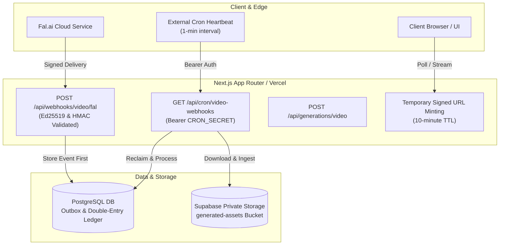

# YourAI Staging Configuration, Migration & Verification Runbook

- **Document ID**: RUNBOOK-STAGING-001
- **Version**: 1.0.0
- **Effective Date**: 2026-11-11
- **Status**: APPROVED / ACTIVE
- **Scope**: Staging Infrastructure Deployment, Database Migrations, Supabase Storage Hardening & Webhook Ingress

---

## 1. Overview & Architecture Boundaries

This runbook provides the definitive operational blueprint for provisioning, configuring, and verifying the **YourAI Staging Environment** with Stage 8 Video Generation capabilities.

### Strict Operational Principles:
1. **Separation of Configuration vs. Verification**: Every configuration section is paired with an independent, non-destructive verification command to confirm success before proceeding.
2. **Deterministic Rollback Capability**: Every database change has a pre-migration backup and reverse SQL rollback script.
3. **Defense-in-Depth Storage**: Video assets are stored exclusively in private Supabase buckets accessible only via time-limited cryptographic signed URLs (10-minute TTL).
4. **Resilient Background Execution**: Webhook events and worker leases are decoupled from memory and recovered via external cron heartbeats.



---

## 2. Environment Variables & Secret Configuration

### Required Variables Reference

| Variable Name | Description | Sensitivity | Staging Format / Value | Default Fallback |
| :--- | :--- | :--- | :--- | :--- |
| `DATABASE_URL` | Runtime PostgreSQL connection string (Supabase pooler or direct) used by the app and the clipper worker. Must enable verified TLS: `sslmode=verify-full&sslrootcert=<absolute CA path>` (without `sslmode` node-postgres connects unencrypted). In containers, mount the Supabase root CA at that path. | **SECRET** | `postgresql://postgres.[REF]:[PASSWORD]@[POOLER-HOST]:5432/postgres?sslmode=verify-full&sslrootcert=/run/certs/supabase-root.crt` | None (Required) |
| `MIGRATE_DATABASE_URL` | Optional. Prisma CLI only (`migrate deploy/status`); schema-engine TLS parameters. Must name the same database as `DATABASE_URL`, otherwise the CLI refuses to run (`prisma/cli-database-url.ts`). Not used at build time. | **SECRET** | `...?sslmode=require&sslcert=<CA path>&sslaccept=strict` | Falls back to `DATABASE_URL` |
| `AUTH_SECRET` | Secret key for signing Auth.js session JWT tokens. | **SECRET** | 64-char hex (`openssl rand -hex 32`) | None (Required) |
| `AUTH_TRUST_HOST` / `AUTH_URL` | One is required in production: `AUTH_TRUST_HOST=true` behind a proxy, or the canonical `AUTH_URL`. | Config | `true` | None (Required) |
| `APP_ORIGIN` | Public canonical staging URL for CSRF validation. | Public | `https://staging.yourai.internal` | None (Required) |
| `CLOUDFLARE_ACCOUNT_ID`, `CLOUDFLARE_AI_API_TOKEN` | Workers AI credentials for image generation. | **SECRET** (token) | — | None (Required) |
| `CRON_SECRET` | Bearer token for all three cron endpoints (§6). | **SECRET** | 64-char hex (`openssl rand -hex 32`) | None (Required; startup fails without it) |
| `FAL_KEY` | Fal.ai API key for queue submission and model inference. | **SECRET** | `fal_key_...` | None (Required when `STAGE_8_QA_ALLOWLIST` is set) |
| `FAL_WEBHOOK_URL` | Public webhook ingress URL delivered to Fal.ai. | Public | `${APP_ORIGIN}/api/webhooks/video/fal` | Automatically defaults to `${APP_ORIGIN}/api/webhooks/video/fal` |
| `WEBHOOK_CORRELATION_SECRET` | Secret used to compute HMAC correlation tokens (`?token=`). | **SECRET** | 64-char hex (`openssl rand -hex 32`) | Falls back to `AUTH_SECRET` if unset |
| `SUPABASE_URL` | Supabase project URL. | Public | `https://[PROJECT-ID].supabase.co` | None (Required) |
| `SUPABASE_SECRET_KEY` | Supabase Service Role API key (Full administrative access). | **SECRET** | `eyJhbGciOi...` | None (Required) |
| `SUPABASE_STORAGE_BUCKET` | Private bucket for all generated and uploaded media (images, videos, clips, clipper uploads). | Public | `generated-assets` | None in production (Required; image storage has no default) |
| `STAGE_8_QA_ALLOWLIST` | Video on-switch: comma-separated user IDs (preferred) or verified emails allowed to generate videos. The legacy name `STAGE_8_QA_USER_EMAILS` is **not read** by the app (startup validation flags it). | Config | `<qa-user-id>` | Empty = video disabled for everyone |
| `ADMIN_USER_IDS` | Comma-separated user IDs with admin/moderation access. | Config | `<admin-user-id>` | Empty = no admins |
| `CLIPPER_SUBMISSIONS_ENABLED` | Clipper on-switch for new submissions (production: ON only when exactly `true`). Enable only while a clipper worker is running. | Config | `false` | OFF |
| `CLIPPER_WORKER_ENABLED` | Worker process opt-in (worker container only). | Config | `true` (worker only) | Worker refuses to start |
| `NODE_ENV` | Runtime environment mode. Payments are disabled whenever this is `production`. | Config | `production` | `development` |

Startup validation: `src/instrumentation.ts` runs `enforceStartupEnv()` (`src/lib/env-startup.ts`) when a server instance starts. In production any missing/invalid variable above aborts startup with an error that lists **names only**. Feature-specific variables are only required when the feature is switched on. Payment variables (`RAZORPAY_WEBHOOK_SECRET`, `MOCK_*`) are not required: purchases are disabled in production (see §6).

---

### Configuration Procedure

1. **Populate Staging `.env`**:
   Copy `.env.example` to staging host or cloud secret store:
   ```bash
   cp .env.example .env.staging
   ```
2. **Generate Cryptographic Secrets**:
   Generate distinct cryptographic secrets for `AUTH_SECRET`, `CRON_SECRET`, and `WEBHOOK_CORRELATION_SECRET`:
   ```bash
   openssl rand -hex 32  # For AUTH_SECRET
   openssl rand -hex 32  # For CRON_SECRET
   openssl rand -hex 32  # For WEBHOOK_CORRELATION_SECRET
   ```

---

### Verification Procedure: Configuration Sanity Check

Run the offline configuration and secret check:
```bash
# Verify environment syntax and variable presence
node -e "
  const required = ['DATABASE_URL', 'AUTH_SECRET', 'APP_ORIGIN', 'CRON_SECRET', 'SUPABASE_URL', 'SUPABASE_SECRET_KEY'];
  const missing = required.filter(k => !process.env[k]);
  if (missing.length) {
    console.error('Missing required environment variables:', missing);
    process.exit(1);
  } else {
    console.log('All required environment variables are set.');
  }
"
```

---

## 3. Database Pre-Migration Backup & Deployment

Stage 8 introduces two non-locking, idempotent database migrations:
1. `20261111083000_add_video_generation_fields`: Adds `ingestionToken`, `ingestionLeaseExpiresAt`, `durationSeconds`, `thumbnailKey`, and data integrity check constraints.
2. `20261111120000_add_provider_webhook_events`: Creates `ProviderWebhookEvent` table, `WebhookEventStatus` enum, and compound indexes.

---

### Configuration Procedure: Deployment Steps

#### Step 1: Pre-Migration Database Backup
Execute the full database snapshot tool before applying any migration:
```bash
npm run backup:db
```
*Expected Result*: A timestamped, chunk-framed backup artifact is created in `backups/db-backup-<timestamp>.json` with complete SHA-256 integrity checksums.

#### Step 2: Deploy Pending Migrations
Apply the migrations using Prisma Migrate in non-interactive production mode:
```bash
npx prisma migrate deploy
```

---

### Verification Procedure: Migration State Audit

1. **Verify Prisma Migration Status**:
   ```bash
   npx prisma migrate status
   ```
   *Expected Output*: `Database schema is up to date!`

2. **Verify Database Table & Check Constraints**:
   Execute SQL verification queries against the staging database:
   ```sql
   -- 1. Verify ProviderWebhookEvent table existence
   SELECT table_name FROM information_schema.tables WHERE table_name = 'ProviderWebhookEvent';

   -- 2. Verify GenerationJob columns and check constraints
   SELECT column_name, data_type 
   FROM information_schema.columns 
   WHERE table_name = 'GenerationJob' 
     AND column_name IN ('ingestionToken', 'ingestionLeaseExpiresAt');

   -- 3. Verify check constraints
   SELECT conname, contype 
   FROM pg_constraint 
   WHERE conname IN ('GenerationJob_ingestion_lease_consistency', 'GeneratedAsset_duration_positive');
   ```
   *Expected Result*: All tables, columns, indexes, and constraints return positive records.

---

## 4. Emergency Database Recovery, Migration Reconciliation & Non-Routine Rollback Procedures

> [!IMPORTANT]
> **OPERATIONAL HIERARCHY: FORWARD FIXES OR SNAPSHOT RESTORATION STRONGLY PREFERRED.**
> In production and staging operations, manual modification or deletion of migration records from `_prisma_migrations` is **NOT a routine rollback mechanism** and carries substantial risks of schema divergence.
> 1. **Preferred Approach 1 (Forward-Fix Migration)**: The standard and safest operational path is always to roll forward — creating a new migration that cleanly amends, removes, or replaces problematic schema components. This preserves migration history immutability and team synchronization without risking migration state divergence.
> 2. **Preferred Approach 2 (Verified Database Snapshot Restoration)**: If an unrecoverable failure occurs during initial staging deployment before active user traffic, restoring from a verified pre-migration backup (`npm run restore:db`) is preferred over manual DDL surgery, ensuring complete relational and catalog consistency.
> 3. **Emergency Fallback Only (Manual DDL & Migration History Deletion)**: Manual execution of reverse DDL and deletion of rows from `_prisma_migrations` is an exceptional emergency intervention. It **STRICTLY REQUIRES EXPLICIT DATABASE-OWNER APPROVAL**, an independently reviewed recovery plan, and an immediate verified pre-execution snapshot (`npm run backup:db`). It must **NEVER be treated or executed as a routine rollback procedure**.

> [!CAUTION]
> **CRITICAL WARNING: DATA LOSS RISK AFTER ACTIVE USAGE.**
> Executing manual migration rollbacks after new video jobs or assets have used the added schema **WILL CAUSE PERMANENT, IRREVERSIBLE DATA LOSS**:
> - `DROP TABLE "ProviderWebhookEvent"` permanently destroys all webhook delivery payloads, retry counters, and event audit histories.
> - `DROP COLUMN "durationSeconds"` and `DROP COLUMN "thumbnailKey"` permanently destroys video playback duration and poster thumbnail references for all video `GeneratedAsset` records created under Stage 8.
> - `DROP COLUMN "ingestionToken"` and `DROP COLUMN "ingestionLeaseExpiresAt"` wipes all active ingestion leases from `GenerationJob`.
>
> **MANDATORY PRE-ROLLBACK REQUIREMENTS (DATABASE-OWNER APPROVAL REQUIRED):**
> 1. **Explicit Database-Owner Approval**: Written sign-off from the database owner / Lead SRE confirming forward-fix or snapshot restore is unviable.
> 2. **Verified Backup**: A fresh, complete database backup MUST be created and verified (`npm run backup:db`) immediately before any manual DDL intervention.
> 3. **Reviewed Recovery Plan**: A formal rollback justification and data preservation plan must be reviewed and signed off.
> 4. **Traffic Freeze**: Ingress traffic to `/api/generations/video`, `/api/webhooks/video/fal`, and `/api/cron/video-webhooks` must be paused or blocked before running rollback scripts.

> [!NOTE]
> **NON-EXECUTION NOTICE:**
> The rollback SQL scripts below have been syntactically and structurally validated offline against the PostgreSQL schema definitions. **No live database rollback drill has been performed on staging or production infrastructure** (adhering strictly to the project's ₹0 expenditure and zero-mutation boundary). Any live execution must occur only in a dedicated test database with a verified pre-rollback snapshot.

---

### Prisma Migration History Reconciliation Architecture (Emergency Fallback)

Prisma Migrate tracks applied schema migrations in an internal database table named `_prisma_migrations`. Each row stores:
- `migration_name`: The directory name (e.g. `20261111120000_add_provider_webhook_events`).
- `checksum`: SHA-256 hash of the applied `migration.sql` file.
- `finished_at`: Timestamp indicating successful completion.

When emergency DDL rollback is executed manually in PostgreSQL with explicit database-owner approval, the database DDL and Prisma's tracking table will diverge unless explicitly reconciled:
1. **Reconciliation Invariant**: If you drop tables or columns manually in PostgreSQL without deleting the corresponding rows in `_prisma_migrations`, Prisma will believe the migrations are already applied and will NOT re-apply them if redeployed.
2. **Checksum Invariant**: If migration files in `prisma/migrations/` are modified or removed while rows remain in `_prisma_migrations`, subsequent `prisma migrate deploy` commands will abort with `P3005: Database schema is out of sync` or checksum mismatch errors.
3. **Emergency Reconciliation Protocol**:
   - Step A: Verify database-owner approval and verified snapshot.
   - Step B: Execute the reverse DDL SQL scripts.
   - Step C: Atomically remove the migration rows from `_prisma_migrations` (`DELETE FROM "_prisma_migrations" WHERE ...`).
   - Step D: If the codebase is also rolled back, checkout the pre-migration `schema.prisma`.
   - Step E: Run `npx prisma migrate status` to confirm that the database schema and migration history are 100% reconciled.

---

### Rollback Step 1: Reverse Migration `20261111120000_add_provider_webhook_events`

Execute the following SQL script to drop the webhook outbox table and reconcile Prisma tracking:
```sql
BEGIN;

-- 1. Drop outbox table and associated indexes (DATA LOSS: All stored webhook payloads destroyed)
DROP TABLE IF EXISTS "ProviderWebhookEvent" CASCADE;

-- 2. Drop webhook status enum
DROP TYPE IF EXISTS "WebhookEventStatus" CASCADE;

-- 3. Reconcile Prisma migration history table
DELETE FROM "_prisma_migrations" 
WHERE "migration_name" = '20261111120000_add_provider_webhook_events';

COMMIT;
```

---

### Rollback Step 2: Reverse Migration `20261111083000_add_video_generation_fields`

Execute the following SQL script to drop check constraints, indexes, and columns:
```sql
BEGIN;

-- 1. Drop check constraints
ALTER TABLE "GeneratedAsset" DROP CONSTRAINT IF EXISTS "GeneratedAsset_duration_positive";
ALTER TABLE "GenerationJob" DROP CONSTRAINT IF EXISTS "GenerationJob_ingestion_lease_consistency";

-- 2. Drop index
DROP INDEX IF EXISTS "GenerationJob_status_ingestionLeaseExpiresAt_idx";

-- 3. Drop asset duration and thumbnail columns (DATA LOSS: Asset duration and thumbnail keys destroyed)
ALTER TABLE "GeneratedAsset" DROP COLUMN IF EXISTS "thumbnailKey";
ALTER TABLE "GeneratedAsset" DROP COLUMN IF EXISTS "durationSeconds";

-- 4. Drop job ingestion lease columns
ALTER TABLE "GenerationJob" DROP COLUMN IF EXISTS "ingestionLeaseExpiresAt";
ALTER TABLE "GenerationJob" DROP COLUMN IF EXISTS "ingestionToken";

-- 5. Reconcile Prisma migration history table
DELETE FROM "_prisma_migrations" 
WHERE "migration_name" = '20261111083000_add_video_generation_fields';

COMMIT;
```

---

### Verification Procedure: Post-Rollback Migration Reconciliation Audit

After executing both rollback scripts and reverting `prisma/schema.prisma` if applicable:
```bash
npx prisma migrate status
```
*Expected Output*: Prisma confirms that the rolled-back migrations are no longer marked as applied in `_prisma_migrations`, and the database schema is clean and synchronized with the expected codebase state.

---

## 5. Supabase Private Storage Security Configuration

User generations and uploads contain private user content and must never be exposed publicly. The application never creates the bucket; an operator creates it once per environment.

---

### Configuration Procedure

1. **Create Storage Bucket** (one bucket serves image, video and clipper):
   In the Supabase Dashboard (`Storage` -> `Buckets`) or via Supabase Management API:
   - **Bucket Name**: `generated-assets`
   - **Public Bucket**: **OFF** (Strictly Private)
   - **Allowed MIME types**: exactly `image/webp`, `video/mp4`, `video/quicktime`, `video/webm`
   - **Max file size limit**: `52428800` bytes (50 MiB)

   Why these values (code limits; the bucket must be at least as permissive, and no more):

   | Feature | Objects written | MIME | App limit |
   | :--- | :--- | :--- | :--- |
   | Image | `users/{userId}/images/{jobId}/{assetId}.webp` | `image/webp` | 5 MiB |
   | Video | `users/{userId}/videos/{jobId}/{assetId}.mp4` + WebP poster | `video/mp4`, `image/webp` | 35 MiB / 1 MiB |
   | Clipper uploads | `ephemeral/users/{userId}/uploads/{id}.{mp4,mov,webm}` | `video/mp4`, `video/quicktime`, `video/webm` | 50 MiB (`CLIPPER_MAX_UPLOAD_BYTES`) |
   | Clipper outputs | `users/{userId}/clips/{jobId}/...` + WebP thumbnails | `video/mp4`, `image/webp` | 30 MiB / 1 MiB |

   A bucket created earlier as image-only (`image/webp`, 5 MiB) rejects every video and clipper write and must be updated before those features are enabled. Do not raise `CLIPPER_MAX_UPLOAD_BYTES` above the bucket limit.
2. **Configure Storage Row-Level Security (RLS)**:
   Ensure that the `storage.objects` table enforces private access:
   - Service Role key (`SUPABASE_SECRET_KEY`) has full bypass permissions for backend ingestion and signing.
   - Public / Anonymous role (`anon`) has **ZERO** read or write permissions.
   - Object keys must stay inside the per-user namespaces listed above.

---

### Verification Procedure: Private Storage Hardening Audit

1. **Verify Bucket Privacy via API**:
   ```bash
   # Unauthenticated GET request to raw object path must return 400/401/403
   curl -I "https://${SUPABASE_PROJECT_ID}.supabase.co/storage/v1/object/public/generated-assets/users/test/videos/test.mp4"
   ```
   *Expected Response*: `HTTP/1.1 400 Bad Request` or `HTTP/1.1 404 Not Found` (Bucket is not public).

2. **Verify Signed URL Playback via Browser / CSP**:
   - Inspect Content Security Policy in `next.config.ts`:
     Must include `"media-src 'self' blob: data: https://*.supabase.co"`.
   - Mint a temporary signed URL via backend storage helper and verify playback within HTML5 `<video>` player without CSP block errors.

---

## 6. External Cron Heartbeat Scheduling

YourAI does not require expensive managed message queues (AWS SQS, Upstash, BullMQ). Background recovery is triggered by periodic authenticated HTTP GET requests. **Three endpoints must be scheduled**; all use the same `CRON_SECRET` and all fail closed (401) when it is unset in production.

| Endpoint | Schedule | What it does | Needed when |
| :--- | :--- | :--- | :--- |
| `/api/cron/video-webhooks` | every 1–5 min | Sweeps expired webhook leases, processes the Fal.ai webhook outbox, ingests ready results, reconciles stale video jobs (refunds) | Video enabled |
| `/api/cron/clipper` | every 5 min | Reconciles stale clip jobs (refunds), retries failed ephemeral-object cleanups, sweeps expired uploads | Clipper enabled |
| `/api/cron/billing` | every 5–15 min | Retries stored payment webhook events left PENDING (or with expired leases) and reconciles stuck payment orders. Database-only; makes no gateway calls. A no-op while purchases are disabled | Always (harmless) |

Image jobs have no cron: a stale image job is reconciled (and its credit refunded) the next time the same user generates or polls.

The clipper also needs its **worker process** (it is not an HTTP endpoint): run the Docker image built with `--target clipper-worker` (bundled `dist/clipper-worker.mjs` + Alpine `ffmpeg`/`ffprobe`) with `CLIPPER_WORKER_ENABLED=true` and the same `DATABASE_URL` / `SUPABASE_*` variables as the app. Run exactly one worker; only then set `CLIPPER_SUBMISSIONS_ENABLED=true` on the web app.

**Payments:** no live gateway is integrated. With `NODE_ENV=production`, `POST /api/billing/orders`, `POST /api/billing/verify` and `POST /api/webhooks/payments/razorpay` return `503 PURCHASES_DISABLED`, the mock gateway is rejected, and the UI shows "Purchases coming soon". This is enforced in code (`src/features/billing/availability.ts`), not by an environment flag.

---

### Configuration Procedure

Configure an external cron scheduler (e.g. GitHub Actions, Cloudflare Cron Triggers, cron-job.org, or AWS EventBridge) for each endpoint in the table above:
- **Target URLs**: `https://staging.yourai.internal/api/cron/video-webhooks`, `.../api/cron/clipper`, `.../api/cron/billing`
- **HTTP Method**: `GET`
- **Schedule**: as in the table (every 1–5 minutes for video, 5 minutes for clipper, 5–15 minutes for billing)
- **Headers**:
  ```http
  Authorization: Bearer <CRON_SECRET>
  User-Agent: YourAI-Cron-Trigger/1.0
  ```

#### Example GitHub Actions Workflow (`.github/workflows/cron-heartbeat.yml`)
```yaml
name: Video Background Heartbeat
on:
  schedule:
    - cron: '*/5 * * * *'  # Every 5 minutes
jobs:
  heartbeat:
    runs-on: ubuntu-latest
    steps:
      - name: Trigger Cron Worker
        run: |
          for path in video-webhooks clipper billing; do
            curl -f -s -H "Authorization: Bearer ${{ secrets.STAGING_CRON_SECRET }}" \
              "https://staging.yourai.internal/api/cron/$path"
          done
```

---

### Verification Procedure: Heartbeat Response & Recovery

1. **Test Unauthenticated Rejection**:
   ```bash
   curl -i https://staging.yourai.internal/api/cron/video-webhooks
   ```
   *Expected Response*: `HTTP/1.1 401 Unauthorized` (`{"error":"Unauthorized"}`).

2. **Test Authenticated Execution**:
   ```bash
   curl -i -H "Authorization: Bearer <CRON_SECRET>" https://staging.yourai.internal/api/cron/video-webhooks
   ```
   *Expected Response*: `HTTP/1.1 200 OK`
   ```json
   {
     "success": true,
     "timestamp": "2026-11-11T12:00:00.000Z",
     "summary": {
       "eventsProcessed": 0,
       "eventsFailed": 0,
       "expiredLeasesReclaimed": 0,
       "staleJobsReconciled": 0
     }
   }
   ```

---

## 7. Public Fal.ai Webhook Ingress & DNS Configuration

Fal.ai requires a publicly accessible HTTPS endpoint to deliver asynchronous video completion payloads.

---

### Configuration Procedure

1. **Determine Public Ingress URL**:
   - In Staging: `https://staging.yourai.internal/api/webhooks/video/fal`
   - In Local / Preview Testing: Use a secure tunnel:
     ```bash
     # Cloudflare Tunnel
     cloudflared tunnel --url http://localhost:3000
     # Or Ngrok
     ngrok http 3000
     ```
2. **Set `FAL_WEBHOOK_URL`**:
   Ensure `FAL_WEBHOOK_URL` points to the public tunnel/staging URL (e.g. `https://xxxx.trycloudflare.com/api/webhooks/video/fal`).

---

### Verification Procedure: Signature & Correlation Validation

1. **Verify Ed25519 Rejection of Forged Webhooks**:
   Send an unsigned POST request to the webhook endpoint:
   ```bash
   curl -i -X POST "https://staging.yourai.internal/api/webhooks/video/fal?jobId=vjob-test" \
     -H "Content-Type: application/json" \
     -d '{"status":"OK"}'
   ```
   *Expected Response*: `HTTP/1.1 401 Unauthorized` (Missing or invalid Fal.ai signature headers).

2. **Verify Correlation Token Enforcement**:
   Send a request with an invalid or tampered correlation token:
   ```bash
   curl -i -X POST "https://staging.yourai.internal/api/webhooks/video/fal?jobId=vjob-test&token=invalid-token" \
     -H "Content-Type: application/json" \
     -d '{"status":"OK"}'
   ```
   *Expected Response*: `HTTP/1.1 401 Unauthorized` (Correlation token verification failed).

---

## 8. Operator CLI Quick Reference

When an ambiguous provider submission occurs (e.g., Fal.ai queue timeout, gateway drop), operators use `scripts/resolve-ambiguous-job.mts` to settle the job.

### Common Operational Commands

```bash
# 1. Dry-Run Inspection (Default — Zero Database Writes)
npx tsx scripts/resolve-ambiguous-job.mts \
  --job-id="vjob-001" \
  --action=failed \
  --operator="ops-alice" \
  --reason="Fal.ai request dropped; queue verification confirmed non-execution"

# 2. Confirmed Refund Resolution (Issues Ledger Credit Refund)
npx tsx scripts/resolve-ambiguous-job.mts \
  --job-id="vjob-001" \
  --action=failed \
  --operator="ops-alice" \
  --reason="Fal.ai request dropped; queue verification confirmed non-execution" \
  --confirm

# 3. Confirmed Completion Resolution (Attaches Asset & Finalizes Charge)
npx tsx scripts/resolve-ambiguous-job.mts \
  --job-id="vjob-002" \
  --action=completed \
  --operator="ops-alice" \
  --reason="Provider completed output; manual webhook recovery" \
  --storage-key="users/usr_123/videos/vjob-002/vasset-001.mp4" \
  --size-bytes=2458190 \
  --width=1280 \
  --height=720 \
  --duration=5.0 \
  --confirm
```

---

## 9. Staging Setup & Verification Checklist

Complete this checklist prior to greenlighting staging for end-to-end testing:

| Stage | Activity | Type | Status | Sign-off |
| :--- | :--- | :--- | :--- | :--- |
| **Phase 1** | Populate staging `.env` with required keys | Configuration | [ ] PENDING | |
| **Phase 1** | Verify `AUTH_SECRET`, `CRON_SECRET`, `WEBHOOK_CORRELATION_SECRET` entropy | Verification | [ ] PENDING | |
| **Phase 2** | Execute pre-migration database snapshot (`npm run backup:db`) | Operational | [ ] PENDING | |
| **Phase 2** | Deploy Prisma migrations (`npx prisma migrate deploy`) | Configuration | [ ] PENDING | |
| **Phase 2** | Verify migration status and schema check constraints | Verification | [ ] PENDING | |
| **Phase 3** | Create private Supabase bucket `generated-assets` (50 MiB; `image/webp`, `video/mp4`, `video/quicktime`, `video/webm`) | Configuration | [ ] PENDING | |
| **Phase 3** | Verify anonymous access is blocked on Supabase bucket | Verification | [ ] PENDING | |
| **Phase 4** | Configure external cron heartbeats for `video-webhooks`, `clipper` and `billing` | Configuration | [ ] PENDING | |
| **Phase 4** | Run one clipper worker (`--target clipper-worker`) before enabling `CLIPPER_SUBMISSIONS_ENABLED` | Configuration | [ ] PENDING | |
| **Phase 4** | Verify authenticated cron trigger returns HTTP 200 | Verification | [ ] PENDING | |
| **Phase 5** | Verify public webhook ingress endpoint and Ed25519 validation | Verification | [ ] PENDING | |
| **Phase 6** | Execute single controlled E2E test video generation | Verification | [ ] PENDING | |
| **Phase 7** | Verify double-entry credit ledger debit and balance consistency | Verification | [ ] PENDING | |

